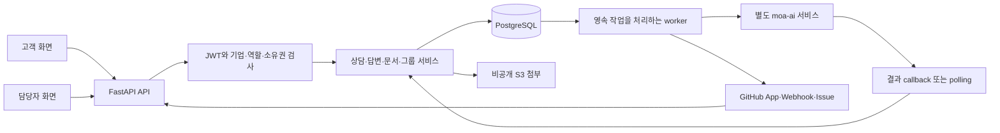
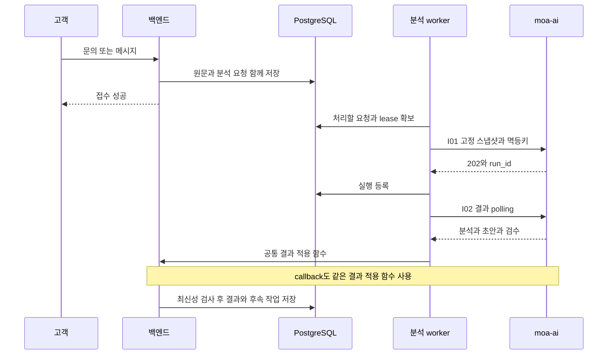

# MOA 백엔드 기술 구조와 처리 로직

MOA는 고객 문의를 접수하고, AI 분석·근거 검색·답변 초안을 담당자 업무와 연결하며, 반복되는 오류 문의를 그룹과 GitHub Issue로 이어 주는 상담 지원 시스템이다. 백엔드의 핵심 책임은 **권한이 있는 사용자의 요청을 저장하고, 현재 문의와 근거에 유효한 결과만 반영하며, 외부 서비스 실패를 복구 가능한 상태로 보존하는 것**이다.

기준은 2026-11-05의 `origin/main` 커밋 `c696348`이다. 실제 구현 설명은 이 커밋의 코드와 OpenAPI를 따른다. 과거 단계별 운영 문서의 숫자 ID·영문 Enum·미구현 범위 설명과 다를 수 있다. 발표용 답변과 데모 순서는 [기술 질의응답](TechnicalQA.md)을 참고한다.

이 문서의 “왜”는 현재 코드가 제공하는 효과와 설계상 이유를 설명한다. 성능 수치·모델 정확도·운영 SLA를 측정한 결과는 아니다.

## 1. 전체 구조와 책임

| 경계 | 실제 책임 | 대표 코드 |
|---|---|---|
| `api` | HTTP 경로·상태코드·입력·응답 모델·의존성 연결 | [router](../app/api/v1/router.py) |
| `deps` | 요청별 DB 세션, 고객 JWT, 역할 검사, AI callback 인증 | [auth](../app/deps/auth.py), [db](../app/deps/db.py) |
| `schemas` | 요청·응답 계약, Enum·ID·길이·추가 필드 검증 | [inquiries](../app/schemas/inquiries.py), [analysis](../app/schemas/analysis.py) |
| `services` | 권한 범위, 상태 전이, 트랜잭션, 결과 최신성, 외부 작업 등록 | [analysis](../app/services/analysis.py), [answers](../app/services/answers.py) |
| `db/models` | 관계·제약·인덱스·영속 상태 | [models](../app/db/models/__init__.py) |
| `workers` | DB 작업 확보, 외부 전달, polling, 재시도와 복구 | [analysis worker](../app/workers/analysis.py) |
| `core` | 설정·보안·cursor·ID와 S3·AI·GitHub 통신 경계 | [core](../app/core/) |

백엔드 자체는 하나의 애플리케이션과 공통 DB를 중심으로 기능을 분리한 구조다. AI는 HTTP로 연결되는 별도 서비스다. 백엔드의 모든 모듈을 독립 마이크로서비스로 배포하는 구조는 아니다.

**AI와 백엔드의 구분**

- AI: 분류·긴급도·요약·유사 문의 후보·근거 검색·초안·검수 결과 생성.
- 백엔드: 사용자 인증, 기업 격리, 원문 저장, 분석 입력 고정, 결과 최신성 검사, 그룹 최종 결정, 발송 정책, 답변·평가 저장, 외부 작업 복구.
- AI의 답변을 받았다는 사실만으로 고객에게 발송하지 않는다. 서버 정책과 근거 검증을 별도로 통과해야 한다.
- LLM prompt, embedding 생성, vector 저장소 내부 구현은 이 저장소의 코드 범위 밖이다.

## 2. 사용 기술과 선택의 효과

버전은 최신 제품 버전 소개가 아니라 [requirements.txt](../requirements.txt)의 고정값이다. Python 3.12는 현재 GitHub Actions 설정 기준이다.

| 기술 | 버전 또는 구성 | 사용 목적과 효과 |
|---|---|---|
| Python | CI 3.12 | API·worker·데이터 검증을 같은 언어로 구현 |
| FastAPI / Uvicorn | 0.162.0 / 0.54.0 | 비동기 HTTP API, 의존성 주입, OpenAPI 제공 |
| Pydantic / Settings | 2.14.2 / 2.16.2 | 요청·AI 응답 검증, 환경설정 타입과 비밀값 관리 |
| SQLAlchemy / asyncpg | 2.1.8 / 0.32.0 | 비동기 PostgreSQL 접근, 명시적 트랜잭션·행 잠금 |
| PostgreSQL | 서버 버전은 이 저장소에서 고정하지 않음 | FK·유일성 제약, JSONB, sequence, 행 잠금, advisory lock, 영속 작업 |
| Alembic | 1.20.1 | 버전별 schema 변경과 분기 병합 |
| PyJWT / pwdlib / Argon2 | 2.15.1 / 0.3.1 / argon2-cffi 25.1.0 | access token 서명과 비밀번호 해시 |
| HTTPX | 0.28.1 | AI·GitHub 비동기 HTTP 통신, timeout과 오류 분류 |
| boto3 / S3 | 1.43.124 / 비공개 객체 | 첨부 원본 저장, 권한 검사 후 만료 URL 발급 |
| PDFium / Pillow / Tesseract | pypdfium2 5.14.0, Pillow 12.3.0, pytesseract 0.3.13 | PDF 텍스트 추출·이미지 처리·한영 OCR |
| GitHub App | OAuth·PKCE·App JWT·installation token | 관리 가능한 설치 검증, 선택 저장소 접근, webhook·Issue 연동 |
| pytest / HTTPX ASGITransport | [개발 의존성](../requirements-dev.txt) | 실제 PostgreSQL과 HTTP 대역을 이용한 자동 검증 |
| GitHub Actions / SSH / systemd | [배포 workflow](../.github/workflows/deploy.yml) | main 배포, 환경설정 검증, migration, 서비스 재시작 |

[LLM 운영 기록](LLMOperations.md)에는 AWS Bedrock의 Claude Haiku 4.5, Titan Text Embeddings v2, 1024차원 embedding, EC2 IAM Role 사용이 기록되어 있다. 이는 2026-11-05의 외부 AI 운영 확인 기록이며, 백엔드에 모델을 직접 탑재하거나 OpenAI API를 호출하는 구현은 아니다.

## 3. 데이터 모델과 식별자

현재 SQLAlchemy 모델은 **31개 업무 테이블**이다. Alembic의 `alembic_version`은 이 수에 포함하지 않는다.

| 영역 | 테이블 | 분리한 이유 |
|---|---|---|
| 사용자·기업 | `users`, `tenants`, `refresh_tokens` | 신원·소속과 갱신 토큰 수명을 분리 |
| 상담·대화 | `inquiries`, `messages`, `attachments`, `inquiry_session_events` | 상담의 현재 상태, 순서 있는 원문, 파일, 접속 이벤트를 분리 |
| 멱등 처리 | `idempotency_records` | 재시도 시 동일 업무를 다시 실행하지 않고 결과 복구 |
| 분석 | `analysis_requests`, `analysis_runs`, `analysis_drafts`, `classification_history` | 요청 의도·외부 실행·초안·사람의 확정을 별도 보존 |
| 발송·평가 | `answers`, `feedback`, `automatic_responses` | 최종 답변, 고객 반응, 자동 발송 판단의 근거를 구분 |
| 지식 문서 | `documents`, `document_versions`, `document_counters`, `document_jobs` | 문서 식별, 불변 원문 버전, 기업별 번호, 비동기 작업 |
| GitHub | `github_integrations`, `github_authorizations`, `github_events`, `github_jobs`, `github_sources` | 연결·일회용 인증·webhook·동기화·가공된 원본을 분리 |
| 그룹·외부 전달 | `inquiry_groups`, `group_membership_history`, `surge_episodes`, `issue_jobs`, `inquiry_summary_jobs` | 문의 유형, 소속 변화, 장애 발생 구간, 외부 전달 의도를 분리 |
| 알림 | `alerts`, `alert_reads` | 기업 공통 알림과 사용자별 읽음을 분리 |

핵심 관계는 `Tenant → User / Inquiry / Document / Group / GitHubIntegration`, `Inquiry → Message / AnalysisRequest / Answer / Feedback`, `AnalysisRequest → AnalysisRun → AnalysisDraft`, `Group → SurgeEpisode → IssueJob`이다. 일부 관계는 여러 최신성 검사를 위해 ID를 저장한 참조이며, 모든 논리 연결이 FK인 것은 아니다.

내부 조인에는 주로 BIGINT PK를 사용하고, 공개 API에는 `Q-1001`, `MSG-000001`, `A-1001`, `DRAFT-000001`, `ATT-0001`, `G-001` 같은 문자열 ID를 사용한다. 사용자 공개 ID는 역할별로 `U-2001`, `agent_01`, `admin_01` 형태다. 공개 ID는 DB sequence로 발급하며, ID 자체를 권한 증명으로 사용하지 않는다.

문서의 공개 ID는 기업별 `DOC-001`~`DOC-999`이며 내부 숫자 `doc_id`와 구분한다. 현재 문서 API도 문자열 ID와 한글 Enum을 사용한다. `version`은 원문 버전이고 `source_revision`은 검색 상태 변경 순서다. 둘을 같은 값으로 취급하면 안 된다.

고정 자릿수는 계약상 한도다. 예를 들어 문서 수는 기업별 999개, `agent_` 번호는 두 자리이며 소진 시 오류를 반환한다. 삭제된 번호의 재사용이나 무제한 확장 정책은 구현되어 있지 않다. 근거: [ID 발급](../app/core/ids.py), [문서 발급](../app/services/documents.py).

## 4. 공통 API 규칙과 인증

### 인증과 기업 격리

1. 회원가입 시 비밀번호를 Argon2 기반 해시로 저장한다. 해시·검증 연산은 thread pool에서 실행한다.
2. 로그인 시 HS256 access JWT와 임의 문자열 refresh token을 발급한다. 기본 유효기간은 각각 1시간·7일이며 설정으로 변경한다.
3. refresh token 원문은 DB에 저장하지 않고 SHA-256 해시를 저장한다. 갱신 시 해당 행을 잠근 뒤 만료를 검사하고, 기존 토큰을 삭제하며 새 토큰 쌍을 저장한다.
4. access JWT의 서명·필수 claim·종류·만료·ID 형태를 검사한다. 이어 DB 사용자의 존재와 현재 역할을 확인한다. 기업 소속도 DB에서 읽는다.
5. router가 customer / agent / admin 역할을 검사하고, 서비스 쿼리가 `tenant_id`와 필요한 `customer_id` 조건을 적용한다.

고객은 본인 문의만, 담당자와 관리자는 본인 기업 문의만 처리한다. 다른 기업·고객의 리소스는 일반적으로 404로 응답해 존재 정보를 노출하지 않는다. `source_customer_id`는 외부 앱의 참고 ID이며 로그인 사용자나 소유권을 대체하지 않는다.

현재 회원가입은 역할을 입력받고, 기업 연결은 기업 ID로 수행한다. 초대 승인·관리자 승격 심사·MFA는 별도 기능이다. 따라서 “기업 격리 쿼리를 구현했다”와 “운영 조직 가입까지 검증한다”는 다른 주장이다. 근거: [인증](../app/services/auth.py), [역할 검사](../app/deps/auth.py), [기업 연결](../app/services/tenants.py).

### 요청·오류 계약

- 보호 API는 `Authorization: Bearer ...`를 사용한다. AI callback은 고객 JWT와 다른 별도 서비스 토큰을 사용한다.
- 입력은 Pydantic으로 검증하며 주요 업무 schema는 추가 필드를 거절한다. 입력 오류는 422 대신 **400 `VALIDATION_ERROR`**로 통일한다.
- 오류는 `error.code`, `error.message`, `error.request_id` 구조다. `X-Request-ID`도 반환한다.
- 401은 인증 실패, 403은 역할·기업 소속 부족, 404는 접근 가능한 대상 없음, 409는 상태·최신성·멱등 충돌, 503은 외부 서비스·설정·동기화 불가 등에 사용한다.
- CORS는 지정한 고객·담당자 Origin만 허용한다. 쿠키 인증을 사용하지 않는 현재 구성에서 `allow_credentials=False`다. CORS가 API 인증을 대신하지는 않는다.

### 중복 요청 방지

문의 생성·메시지·답변 등 주요 변경 요청은 `Idempotency-Key`를 받는다. 사용자·업무 경로·키 해시로 범위를 나누고, 정규화한 JSON 본문의 해시와 성공 응답을 저장한다.

- 같은 범위·키·본문: 처음 저장한 결과 재응답.
- 같은 범위·키·다른 본문: 409.
- 동시 요청: `INSERT ... ON CONFLICT DO NOTHING`, 행 잠금, 유일성 제약으로 직렬화.
- 응답 유실: 새 키를 만들지 않고 기존 키·본문을 재전송해야 원래 결과를 복구할 수 있다.

이탈·읽음은 멱등키를 요구하지 않는다. 이탈은 연속 중복 이벤트를 억제하고, 읽음은 저장된 순번보다 큰 값만 반영한다. 모든 POST에 같은 멱등 정책이 적용되는 것은 아니다.

## 5. 문의 접수와 대화 조회

### 최초 접수

`POST /api/v1/inquiries`는 한 트랜잭션에서 문의, 첫 고객 메시지, 고정 접수 안내, 첨부 연결, 분석 요청을 저장한다. 최초 `revision=1`, 메시지 순번은 고객 1·접수 안내 2다. 201은 접수 데이터의 커밋 완료이며 AI 분석 완료가 아니다.

접수 안내의 발신자는 `ai_auto`지만 문구는 고정되어 있다. 이 메시지가 있다는 것만으로 LLM이 호출되었다고 설명하면 안 된다.

### 추가 메시지

`POST /inquiries/{id}/messages`는 문의 행을 잠그고 소유권·종료 여부·멱등키를 검사한다. 성공하면 메시지 순번과 inquiry revision을 증가시키고 상태를 `접수`로 바꾸며 새 분석 요청을 함께 저장한다. 첨부는 같은 고객·기업의 미연결 첨부만 허용한다.

순서는 timestamp나 공개 ID 문자열이 아니라 **문의별 `sequence`**로 결정한다. `(inquiry_id, sequence)` 유일성 제약으로 같은 문의 안의 순번 충돌을 막는다.

### 고객과 담당자 조회

대화는 오래된 순서부터 cursor 방식으로 조회한다. 기본 20개·최대 100개이며, 프론트 계약상 `has_more=true`이면 다음 페이지를 즉시 읽고 없으면 3초 간격으로 폴링한다. 빈 페이지에서도 마지막 cursor를 유지한다.

cursor에는 사용자·기업·문의 또는 목록 필터와 위치가 포함된다. HMAC 서명으로 변조와 다른 조회에 재사용하는 것을 막는다. Base64는 암호화가 아니며, cursor 서명이 리소스 권한 검사를 대체하지 않는다.

고객 응답은 공개 대화·상태·평가·담당자 읽음 위치를 제공한다. 담당자 상세는 분류·환경·revision·분석·초안·검수·답변 승인 이력·고객 이탈과 읽음을 추가한다. 고객에게 내부 초안·코드 근거·검수 원문을 반환하지 않는다.

근거: [문의 서비스](../app/services/inquiries.py), [담당자 조회](../app/services/admin_inquiries.py), [cursor](../app/core/cursor.py).

### 상담 상태 전이

| 사건 | 주요 결과 상태 | 별도로 보존하는 정보 |
|---|---|---|
| 최초 접수·추가 고객 메시지 | `접수` | 메시지 순번·문의 revision·새 분석 요청 |
| 현재 분석 결과 적용 | 일반적으로 `담당자 확인 중` | 완료·실패 run과 검토 상태; 이미 답변·추가 정보 상태이면 해당 상태 보존 가능 |
| 자동 정보 수집 질문 | `추가 정보 필요` | 질문 메시지·고객 응답 대기 |
| 담당자 또는 자동 최종 답변 | `답변 완료` | Answer·공개 Message·승인 또는 정책 판단 |
| 담당자 종료 | `상담 종료` | 종료 시각·평가 요청 |
| 고객 평가 | `상담 종료` 유지 | 별점과 `해결 확인 / 미해결 / 미확인` |
| 이탈·복귀·읽음 | 기존 상담 상태 유지 | presence 또는 읽음 순번 |

이 표는 주요 전이를 설명한다. 수동 분류나 재분석 요청처럼 revision·작업 정보만 바꾸는 API도 있으므로 상태 문자열 하나로 전체 진행 상황을 판단하지 않는다.

## 6. AI 분석의 접수·실행·결과 반영

### 분석 입력을 고정하는 이유

`AnalysisRequest.snapshot`에는 tenant, 문의 ID·revision, 기준 고객 메시지, 당시 대화·첨부 ID·환경, `review_only`를 저장한다. 별도로 백엔드 지식 변경번호와 문서 상태 스냅샷도 보존한다. 나중에 추가된 메시지를 이전 분석의 입력으로 혼합하지 않고, 재시도에도 같은 입력을 재사용하기 위함이다.

대화가 200개를 넘으면 분석 요청을 실패 상태로 기록하고 담당자 알림을 만든다. 문의 원문을 조용히 잘라서 AI에 전달하지 않는다.

### 분석 worker

1. 실행 가능한 작업을 `FOR UPDATE SKIP LOCKED`로 확보한다.
2. 60초 lease와 임의 token을 저장한 뒤 커밋한다. lease는 작업 임시 소유권이며 전체 처리 시간 제한과 다르다.
3. 문의가 이미 변경되거나 종료되었으면 `superseded`로 정리한다.
4. I01 제출 전 시도 횟수·10분 deadline을 저장한다. 외부 요청 키는 분석 요청 ID와 재접수 회차로 결정한다.
5. 202를 받으면 `run_id`를 등록하고 이후 I02를 5초 간격으로 조회한다.
6. 제출은 최대 5회 시도하며, 일시 오류는 지연 후 재시도한다. I02에서 run이 없어지면 이전 실행을 무효화하고 한 번 재접수할 수 있다.
7. 오래된 worker가 돌아와도 token이 현재 소유권과 다르면 결과를 적용하지 않는다.

외부 HTTP는 고정 AI 주소와 서비스 토큰을 사용하며 timeout·응답 크기·schema를 검사한다. 분석 worker는 설정 시 API lifespan에서 시작되고 독립 실행 entry point도 있다.

### 결과 적용과 중복·역순 방지

callback과 polling은 `apply_result`를 공유한다. 다음을 대조한다.

- 서비스 토큰과 tenant.
- 등록한 run 및 연결된 분석 요청.
- 문의 ID, 분석 당시 revision, 기준 고객 메시지.
- 현재 최신 요청인지, 문의가 종료되었는지, run이 대체되었는지.
- 동일 run에 이미 저장된 정규화 결과 hash가 있는지.

| 상황 | 처리 |
|---|---|
| 현재 유효한 결과 | `applied`, 분류·초안·검수·자동 처리·그룹 등 반영 |
| 동일 run의 같은 결과 재수신 | `duplicate`, 고객 메시지 재발송 없음 |
| 예전 문의 revision의 결과 | `ignored_stale`, 현재 상태 덮어쓰기 없음 |
| 동일 run의 서로 다른 최종 결과 | 409 `PIPELINE_RESULT_CONFLICT` |
| 실행 등록보다 먼저 도착한 callback | 409 `RUN_NOT_REGISTERED`, 이후 재전달·polling으로 복구 |

사람이 분류를 확정하면 `classification_manual=True`, 변경 이력, 새 revision을 저장한다. 이후 AI가 수동 분류를 덮어쓰지 않는다.

예를 들어 첫 문의의 revision 1로 분석 A를 시작한 뒤 고객이 내용을 추가해 revision 2와 분석 B가 만들어졌다고 하자. B가 먼저 완료되고 A가 뒤늦게 도착해도 A는 `ignored_stale`다. 같은 B 결과가 callback과 polling으로 두 번 도착하면 두 번째는 `duplicate`다. “오래된 결과”와 “같은 결과의 재전달”을 서로 다르게 처리한다.

`status`, `run_status`, `processing_stage`는 서로 다르다. 예를 들어 상담은 `접수`, 분석은 `처리 중`, 세부 단계는 AI가 반환한 단계명일 수 있다. 무효화된 대기 작업은 worker 정리 전이라도 화면에 계속 대기로 표시하지 않는다.

최근 호환성 수정은 AI의 선택적 `routing`을 검증하고 담당 팀 설명을 `verification.reasons`로 정규화한다. polling과 callback의 결과 지문을 일치시키기 위한 처리이며, 별도 팀 배정 API나 자동 발송 승인 자체를 의미하지 않는다.

근거: [분석 서비스](../app/services/analysis.py), [worker](../app/workers/analysis.py), [AI 계약](../app/schemas/analysis.py), [통신](../app/core/pipeline.py).

## 7. 담당자 답변·자동 응대·종료·평가

### 담당자 발송

담당자는 상세 조회의 문의 revision, 최신 고객 메시지 ID, 백엔드 지식 revision, 선택한 초안 ID·revision을 보내 승인한다. 서버는 잠금 아래 해당 기준이 아직 유효한지 검사한다.

초안 기반 답변은 현재 적용된 초안이어야 하며 문서 근거도 초안에서 검색한 범위 안에서 선택해야 한다. 실제 문서가 같은 기업의 최신 유효 버전인지, 재검토 대상이 아닌지, 검색 가능한지 확인하고 AI I05 상태도 재확인한다. 직접 작성은 초안 없이 가능하며, 문서 근거를 지정하면 동일하게 검증한다. 코드 근거를 직접 고객 답변 근거로 보내는 것은 현재 거절한다.

AI 검수가 실패했어도 담당자가 수정·승인할 수 있다. 다만 오래된 문의·초안·문서까지 승인으로 우회할 수는 없다. 사람의 승인과 AI 검수 통과는 구분해 저장한다.

최종 답변은 `answers`와 고객 채팅 `messages`에 함께 저장하고 상태를 `답변 완료`로 바꾼다. 원본 초안·검수, 최종 본문·근거, 승인자·시각·수정률을 보존한다. 수정률은 `1 - SequenceMatcher(..., autojunk=False).ratio()`이며 의미적 정확도 점수가 아니다. 고객이 답변을 읽었다는 뜻도 아니다.

### 자동 응대

기업별 `AUTO_RESPONSE_POLICIES`에 정책이 없으면 자동 응대는 꺼져 있다. 분석 worker를 켠 것과 자동 답변을 켠 것은 별개다. `review_only=true` 분석은 발송하지 않는다.

자동 질문은 AI 질문 원문 대신 발생 화면·재현 단계·환경·앱 버전·오류 코드에 대한 고정 문구를 사용한다. 허용 항목, 질문 수, 이미 물은 내용을 검사한다. 정책 기본 질문 상한은 2회이고 최대 설정값은 3회다. 성공 시 `추가 정보 필요`로 전환한다.

자동 최종 답변은 아래 조건을 함께 검사한다.

| 검사 축 | 조건 |
|---|---|
| 정책 | 자동 답변 활성화, 허용 category, 허용 문서와 정확한 version |
| 문의 | 높은 긴급도·오류 코드·누락 정보 등이 자동 범위를 벗어나지 않음 |
| 초안 | `초안 가능`, 원본 초안 불변, 같은 기준 메시지에 이미 질문·답변하지 않음 |
| 검수 | 필수 검사 5종 포함, 전체 검사 통과, 근거 없는 문장 없음 |
| 근거 | 문서 인용 존재·일치, 코드·우수 답변 스타일 참조 등 추가 검토 사유 없음 |
| 최신성 | 백엔드 지식 변경번호, 현재 문서·AI 검색 상태 일치, GitHub 연결 문서 동기화 완료 |
| 본문 | 길이·공백 검사와 내부 코드·URL·비밀·개인정보 패턴 필터 통과 |

필수 검사는 `evidence_current`, `source_conflict`, `claims_supported`, `internal_data_excluded`, `auto_response_scope`다. 답변 저장은 담당자 발송과 공통 함수를 쓰며, 자동 발송은 가짜 담당자 계정 없이 `agent_id=null`, `delivery_mode=자동`으로 기록한다. 차단되면 사유를 남기고 담당자 검토로 전환한다. 패턴 필터는 모든 기밀이나 환각을 완벽히 판별하는 장치가 아니다.

### 종료와 평가

최종 답변이 있어야 종료할 수 있다. 종료 시 revision·종료 시각·평가 요청을 기록한다. 종료는 해결 확인이 아니므로 초기 해결 상태는 `미확인`이다. 종료된 문의의 메시지·답변·분류 변경은 거절하며 재개 API는 없다.

고객 평가는 종료된 본인 문의당 최초 한 번만 저장한다. 별점 1~5, 해결 여부, 댓글 중 하나 이상 필요하고 `resolved=false`도 유효하다. 해결 여부와 별점은 독립적이며 미해결 평가가 문의를 자동 재개하지 않는다. 우수 답변 자동 선정 기능은 이 저장소에 구현되어 있지 않다.

근거: [답변](../app/services/answers.py), [자동 응대](../app/services/automatic_responses.py), [자동 정책](../app/core/auto_response.py), [발송 모델](../app/db/models/answer.py).

## 8. 이탈·복귀와 읽음

| API | 기록과 조회 반영 |
|---|---|
| `POST /inquiries/{id}/session-events` | `left`, `new_chat`, `returned`; 담당자 `customer_presence`에 반영 |
| `POST /inquiries/{id}/read` | 고객 읽음; 담당자 `customer_last_read_message_id`로 반환 |
| `POST /admin/inquiries/{id}/read` | 담당자 공통 읽음; 고객 `agent_last_read_message_id`로 반환 |

이탈 이벤트는 `messages`가 아닌 별도 테이블에 저장한다. 따라서 고객 메시지·revision·상담 상태·AI 분석을 변경하지 않는다. 최초에는 `상담 중`, 이탈하면 `나감`과 서버 시각·사유를 제공하며, 복귀하면 현재 이탈 시각·사유를 비운다. 연속 중복은 저장하지 않고 `new_chat` 뒤 `left`는 새 상담 이탈 사유를 유지한다.

읽음은 해당 문의 메시지인지 검증하고 내부 순번으로 전진만 허용한다. 담당자 여러 명의 읽음은 문의별 공통 위치이고, 알림의 사용자별 읽음과 다른 정책이다. GET 조회 자체는 읽음이나 복귀를 기록하지 않는다.

창 닫힘의 `fetch keepalive`는 프론트 호출 방식이다. 마지막 수신 이벤트를 표현할 뿐, 강제 종료·네트워크 단절·여러 탭의 실제 접속 상태를 보장하지 않는다. 담당자 전용 시스템 메시지는 현재 추가하지 않는다. 근거: [활동 기록 서비스](../app/services/inquiry_activity.py).

## 9. 첨부·지식 문서·RAG 동기화

### 첨부

PNG·JPEG·PDF만 허용하고 확장자·MIME·파일 signature·빈 파일·파일명·10MiB 한도를 검사한다. 고객 문의 첨부와 담당자 문서 첨부는 `purpose`로 구분한다. S3 key는 기업·사용자·임의 UUID로 구성한다.

S3는 비공개이며 다운로드 직전 DB 권한 검사를 거쳐 기본 300초 presigned URL을 발급한다. URL을 가진 사람은 유효기간 내 사용할 수 있으므로 영구 공개 주소로 취급하면 안 된다. S3 업로드 후 DB 저장 실패 시 해당 key를 보상 삭제하지만, 이 삭제도 실패하면 고아 파일이 남을 수 있다.

### 문서 버전과 검색 차단

문서 등록은 직접 입력한 text 또는 업로드 첨부 중 하나를 받는다. 새 문서는 버전 1, 기존 문서는 현재 버전의 다음 번호만 허용한다. 원문을 덮어쓰지 않는다.

처리 흐름은 **원본·작업 저장 → 이전 버전 검색 차단 확인 → 추출 → I03 등록 → I05 검색 상태 확인**이다. 외부 AI와 하나의 DB 트랜잭션을 공유할 수 없으므로 변경 의도와 재시도할 payload를 먼저 저장한다.

- 새 버전 등록 시 이전 버전은 폐기·검색 불가로 처리한다. 필요한 I04 차단 확인이 끝나기 전에 새 자료를 안전한 근거로 취급하지 않는다.
- 차단 실패 시 `503 DOCUMENT_SYNC_FAILED`여도 원본·작업은 저장되어 있을 수 있다. 기존 키·본문으로 복구한다.
- `version`은 원문, `source_revision`은 상태 변경 순서, `content_hash`는 텍스트 동일성을 표현한다.
- `indexing_status=완료`와 `searchable=true`는 별개다. 최신 버전·상태·revision·AI 확인이 맞아야 검색 가능하다.
- 원래 자료의 문제를 숨기기 위해 이전 버전을 자동으로 되살리지 않는다. 실패 작업과 원인을 보존한다.

### 추출과 처리 한도

PDF는 내장 텍스트를 우선 사용하고 텍스트가 없는 페이지는 OCR한다. 이미지는 `kor+eng` OCR을 사용한다. 자식 프로세스에서 처리하고 전체 timeout 시 Tesseract 자식까지 종료한다.

| 항목 | 한도 |
|---|---|
| 파일 | 10MiB |
| PDF | 20페이지 |
| 이미지·렌더링 페이지 | 2천만 픽셀 |
| 페이지 OCR / 전체 추출 | 30초 / 300초 |
| 추출 텍스트 | 200,000자 및 비공백 chunk 64개를 모두 만족 |
| chunk 검증 | 1,000자 창, 850자 간격으로 AI 입력 한도 확인 |
| 문서 worker lease | 600초 |
| 일시 오류 재시도 간격 | 5·30·120초 |

64 chunk 제한 때문에 200,000자보다 짧은 입력도 거절될 수 있다. 텍스트를 자동으로 잘라 성공 처리하지 않는다. embedding·실제 vector 검색은 moa-ai의 책임이다.

### 오래된 근거로 발송하지 않는 방법

문서 변경은 기업의 `knowledge_revision`을 DB trigger로 증가시킨다. 분석 당시의 `backend_knowledge_revision`과 현재 값을 비교하고, 인용 문서를 발송 직전 다시 검사한다. AI 응답의 `knowledge_revision`은 별도 체계이므로 두 숫자를 직접 같게 만들지 않는다.

이 방식은 더 이상 유효하지 않은 정책을 근거로 발송하는 것을 막지만, DB와 AI 저장소 전체에 대한 분산 원자성을 제공하지는 않는다. 일부 근거 조회는 잠금을 보유한 상태에서 수행하므로 외부 지연이 해당 기업의 승인·문서 처리 대기로 이어질 수 있다.

근거: [첨부](../app/services/attachments.py), [S3](../app/core/storage.py), [문서](../app/services/documents.py), [인덱싱](../app/services/document_indexing.py), [추출](../app/services/document_extraction.py), [문서 worker](../app/workers/documents.py).

## 10. GitHub 연결과 코드 변경 감지

### 인증과 접근 범위

관리자는 GitHub App 설치와 별도 사용자 인증을 수행한다. state·PKCE·만료·재사용을 검사하고 GitHub 사용자가 관리할 수 있는 해당 App 설치 및 저장소를 확인한다. 사용자가 보낸 `installation_id`만으로 연결을 승인하지 않는다.

사용자 인증 token은 검증에 사용하고 저장하지 않는다. 서버는 App private key로 RS256 JWT를 만들고 installation token을 받아 실제 API를 호출한다. 최종 기능 기준 권한은 Contents Read, Metadata Read, Issues Read and write다. 코드 push 권한은 요구하지 않는다.

| 보안 레벨 | 처리 |
|---|---|
| 0 | GitHub 미사용·연결 해제 |
| 1 | 선택 경로의 메타데이터·커밋 정보, blob 본문 미수집 |
| 2 | 선택 경로의 허용 파일 본문 수집, 제외·마스킹 후 내부용 RAG 전달 |
| 3 | 미지원 |

레벨 1·2는 `external_llm` 경계다. 레벨 2를 로컬 전용 LLM 처리로 설명하지 않는다.

### Webhook과 동기화

1. 원본 body bytes의 HMAC-SHA256 서명을 검사한다. 본문은 2MiB 이하로 제한한다.
2. delivery ID와 본문 hash로 중복을 제거한다. 동일 delivery의 다른 내용은 충돌이다.
3. repository ID·installation ID·감시 브랜치를 대조한다.
4. 영속 동기화 작업과 generation을 기록한다. 오래된 webhook의 SHA를 바로 적용하지 않고 실제 수집 시 현재 HEAD를 다시 읽는다.
5. 선택 경로·확장자·일반 파일만 읽고 `.env*`, key, secrets, dependency 경로, symlink·submodule·binary 등을 제외한다.
6. 알려진 비밀 패턴은 DB·AI 저장 전에 마스킹한다. 발견 보고에는 경로·줄·종류만 남긴다.
7. 변경·삭제·범위 축소된 옛 소스는 검색 차단을 확인한 뒤 새 SHA의 소스를 등록한다. generation·lease token으로 오래된 worker 결과를 막는다.

GitHub 소스는 `내부 전용`이다. 코드 경로와 문서를 연결하는 `document_bindings`가 있으면 관련 변경은 문서를 재검토·검색 불가로 만든다. 새 가격이나 정책을 코드에서 읽었다고 문서의 정답으로 자동 확정하지 않는다. 동기화 중·실패 상태의 연결 문서를 근거로 한 발송도 차단한다.

수집 상한은 tree 10,000 entries, snapshot 200 files, 파일 200KB, 새 텍스트 4MiB다. 너무 큰 tree를 일부만 읽고 전체 동기화 성공으로 처리하지 않는다. GitHub worker lease는 600초, 수집 제한은 300초다.

근거: [연결·webhook](../app/services/github.py), [통신·인증](../app/core/github.py), [보안 필터](../app/services/github_security.py), [동기화](../app/services/github_sync.py), [App 운영 안내](GitHubAppSetup.md).

## 11. 문의 그룹·급증·알림·Issue

### 그룹 결정

AI는 유사 문의 후보를 제공하고, 최종 그룹은 백엔드가 결정한다.

- 오류 코드를 대문자·하이픈 형식으로 정규화한다. 기업 안에서 같은 오류 코드는 같은 그룹으로 연결한다.
- 앱 환경 코드와 AI 코드가 다르면 임의로 하나를 선택하지 않고 그룹 확정을 보류하며 알림을 만든다.
- 오류 코드가 없으면 유사도 **0.85 이상**, 같은 기업·분류, 실제 후보 문의와 그룹의 일치, 코드 없는 그룹 등의 조건을 검사한다.
- 적합한 후보가 없으면 새 그룹을 만든다. 그룹 변경은 이력으로 보존한다.
- 기업별 advisory lock과 DB 유일성 제약으로 동시 분석의 중복 그룹 생성을 제어한다.

### 급증과 장애 구간

**최근 5분 안에 같은 그룹의 실제 문의 8건 이상**이면 급증이다. 분석 완료 시각이 아니라 `received_at`으로 집계하고 `is_seed=true` 데이터는 제외한다.

`SurgeEpisode`는 장애 구간이다. 같은 구간의 문의가 늘어도 매번 새 Issue를 만들지 않는다. 마지막 실제 수신 후 10분간 조용하면 구간을 종료하며, 이후 급증은 새 구간이 될 수 있다. 자동 Issue는 최근 구간에서 `기능 오류` 문의도 8건 이상이어야 한다.

### 알림과 문의 요약

분석 실패·검증 확인 필요·문의 급증·GitHub Issue 실패 알림을 저장한다. 기업과 원인 키로 중복을 막고, 사용자별 읽음은 `alert_reads`에 별도로 저장한다. 알림 본문에는 고객 원문·외부 예외 대신 정해진 안내문을 사용한다.

문의 요약은 `inquiry_summary_jobs`를 통해 AI 검색 자료로 전달한다. 텍스트 변화와 그룹·분류 변화의 revision을 관리하고 이전 버전을 먼저 차단한다. visibility는 내부 전용이다. 요약 동기화 장애가 이미 접수한 문의를 삭제하거나 되돌리지는 않는다.

요약 worker는 lease 대신 **문의별 session advisory lock과 전용 DB 연결**을 사용해 HTTP 단계까지 직렬화한다. 같은 물리 연결에서 잠금을 해제하고, 프로세스가 종료되면 연결과 함께 잠금이 풀린다. 다른 worker와 달리 오래된 요약 HTTP가 새 메타데이터를 추월하지 않도록 잡은 경계다. 근거: [요약 worker](../app/workers/inquiry_summaries.py).

### GitHub Issue 생성

1. 구간별 유일한 `IssueJob`에 최초 본문과 대상 저장소·정책·근거를 고정한다.
2. 고객 원문 대신 문의 ID·건수·허용된 환경 정보·오류 유형을 사용한다.
3. 코드 후보는 현재 유효한 AI 결과와 실제 수집한 경로·commit SHA가 일치하는 경우만 최대 10개 포함한다. 후보는 원인 확정이 아니다.
4. worker는 실제 설치·저장소 숫자 ID·Issues 권한·현재 정책과 근거를 다시 검증한다.
5. 구간 marker가 이미 들어간 Issue를 조회한다. 없으면 전송 의도인 `reconcile` 상태를 먼저 커밋한 후 POST한다.
6. 응답이 유실되면 marker로 재조회한다. 존재 여부를 확인할 수 없으면 `확인 필요`로 남기고 무조건 다시 생성하지 않는다.

이 방식은 중복 생성을 줄이기 위해 불확실한 성공과 확실한 실패를 구분한다. GitHub와 PostgreSQL 사이의 exactly-once나 분산 트랜잭션을 보장한다는 뜻은 아니다.

근거: [그룹](../app/services/groups.py), [알림](../app/services/alerts.py), [Issue 요청](../app/services/group_issues.py), [대상 검증](../app/services/group_github.py), [Issue worker](../app/workers/group_issues.py), [요약](../app/services/inquiry_summaries.py).

## 12. 일관성·동시성·장애 대응의 공통 원칙

| 문제 | 적용한 수단 | 보장 범위 |
|---|---|---|
| 같은 요청의 재시도 | 멱등 레코드·본문 hash·저장 응답 | 같은 업무의 중복 저장 방지 |
| 동시 메시지·발송 | 문의 행 잠금·순번·revision·유일성 제약 | DB 안의 순서와 원자적 저장 |
| 오래된 화면 승인 | expected revision·최신 고객 메시지·초안 검사 | 과거 정보 기반 변경 거절 |
| 오래된 AI 결과 | 최신 요청·run·기준 메시지·결과 hash | 현재 상담 덮어쓰기와 중복 발송 차단 |
| worker 중단 | DB 작업·available_at·lease·token | 만료 후 작업 재확보 및 오래된 소유자 차단 |
| 그룹·알림 경합 | 기업·원인 범위 advisory lock | 논리 리소스 생성 직렬화 |
| 지식 변경 | 기업 변경번호·문서 revision·I05 확인 | 발송 당시의 근거 재검사 |
| 외부 응답 유실 | 동일 payload·event 재시도 또는 marker 조회 | 외부 시스템과의 불일치 복구 |

핵심은 “모든 실패를 rollback”이 아니다. DB 안에서는 원자적으로 저장하지만, 외부로 이미 나갔을 수 있는 작업은 의도·상태·오류를 보존해 복구한다. API의 일반 인메모리 background task만으로 핵심 업무를 관리하지 않는다.

분석 결과 적용은 문의 → 요청 → run 순서로 잠그고, 근거 검증과 문서 작업은 기업 변경번호 → 문서 순서를 맞춘다. 기업 행에는 FK의 KEY SHARE와 호환되는 `FOR NO KEY UPDATE`를 사용한다. 모든 worker가 동일한 lease 시간·재시도 규칙을 갖는 것은 아니다.

DB 기반 작업 관리의 장점은 업무 데이터와 처리 의도를 같은 트랜잭션으로 기록하기 쉽다는 점이다. 대신 polling 비용, worker 수와 DB 부하, 기업 단위 잠금 경합을 관찰해야 한다. 현재 코드에 Redis·Celery·Kafka 의존성은 없다.

행 잠금은 동시에 저장하는 작업의 실행 순서를 제어하고, expected revision은 사용자가 과거 화면을 기준으로 요청했는지 확인한다. 유일성 제약은 코드 검사를 빠져나온 중복도 DB에서 막는다. 역할이 달라 세 가지를 함께 사용한다. PostgreSQL 트랜잭션의 원자성과 외부 GitHub·AI 호출의 성공을 같은 보장으로 설명하지 않는다.

## 13. 실제 API 목록

현재 OpenAPI는 **36개 경로·38개 동작**을 노출한다. 아래 경로는 별도 표시한 health·callback을 제외하고 `/api/v1` 기준이다. 각 요청의 상세 필드·오류는 실행 중인 `/docs` 또는 [API 명세](APISpec.md)를 참고한다.

| 영역 | Method와 경로 | 핵심 책임 |
|---|---|---|
| 공통 | `GET /health` — 루트 경로 | 앱 생존 확인 |
| 인증 | `POST /auth/signup`, `/auth/login`, `/auth/refresh` | 가입·로그인·토큰 회전 |
| 인증 | `GET /auth/me` | 현재 사용자·역할·기업 |
| 기업 | `POST /tenants`, `/tenants/join`; `GET /tenants/me` | 기업 생성·소속 연결·조회 |
| 첨부 | `POST /attachments`; `GET /attachments/{attachment_id}` | 업로드·권한 기반 URL 발급 |
| 고객 | `POST /inquiries`; `POST /inquiries/{inquiry_id}/messages` | 접수·추가 메시지 |
| 고객 | `GET /inquiries/{inquiry_id}` | 공개 대화·읽음·평가 상태 |
| 고객 | `POST /inquiries/{inquiry_id}/session-events`, `/read`, `/feedback` | 이탈·읽음·평가 |
| 담당자 | `GET /admin/inquiries`, `/admin/inquiries/{inquiry_id}` | 목록·내부 상세 |
| 담당자 | `POST /admin/inquiries/{inquiry_id}/read`, `/analysis` | 읽음·재분석 |
| 담당자 | `PATCH /admin/inquiries/{inquiry_id}/classification` | 분류·긴급도 수동 확정 |
| 담당자 | `POST /admin/inquiries/{inquiry_id}/answers`, `/close` | 발송·종료 |
| 지식 | `POST /admin/documents`; `GET /admin/documents` | 버전 등록·상태 조회 |
| 지식 | `PATCH /admin/documents/{doc_id}/versions/{version}/status` | 폐기·재검토·재활성화 |
| 그룹 | `GET /admin/groups`, `/admin/groups/{group_id}` | 그룹·급증·구간 조회 |
| 알림 | `GET /admin/alerts`; `PATCH /admin/alerts/{alert_id}` | 목록·개인 읽음 |
| Issue | `POST /admin/groups/{group_id}/github-issues` | 구간별 수동 생성 요청 |
| GitHub | `POST /admin/integrations/github/authorization`, `/authorization/complete`, `/selection` | 설치·사용자 검증·저장소 선택 |
| GitHub | `POST /admin/integrations/github`; `GET /admin/integrations/github` | 연결 설정·상태 |
| GitHub | `POST /integrations/github/webhook` | 서명된 외부 이벤트 접수 |
| AI callback | `POST /internal/v1/pipeline-results` — 별도 prefix | 완료·실패 결과 반영 |

백엔드가 AI로 호출하는 I01~I05는 위 백엔드 API 개수에 포함하지 않는다. I01은 분석 접수, I02는 실행 조회, I03은 RAG 소스 등록, I04는 소스 상태 변경, I05는 소스 상태 조회다.

## 14. 실행·배포·테스트

### 프로세스

| 프로세스 | 실행 방식 |
|---|---|
| API | FastAPI/Uvicorn, 운영 systemd `moa-backend` |
| 분석 worker | `AI_PIPELINE_WORKER_ENABLED=true`이면 API lifespan에서 실행; 독립 모듈 실행도 지원 |
| 그룹 worker | `GROUPS_WORKER_ENABLED=true`이면 lifespan에서 실행; 독립 `app.workers.groups`도 지원 |
| 문서 worker | 별도 `python -m app.workers.documents` |
| GitHub worker | 별도 `python -m app.workers.github` |
| moa-ai | 별도 AI 서비스; 모델·embedding·검색 설정 관리 |

그룹 worker는 급증 구간 평가를 5초, Issue·요약 작업을 각각 1초 주기로 처리한다. 실행 flag와 systemd 설치 여부가 기능 동작에 영향을 준다. 코드가 있다는 사실만으로 운영 worker가 켜져 있다고 단정하지 않는다.

### 배포 순서

GitHub Actions는 PR과 main push에서 Python 3.12 의존성 설치·애플리케이션 import를 검사한다. **현재 workflow에는 pytest 실행 단계가 없다.** main push만 SSH 배포를 실행하며 동시 배포는 직렬화한다.

배포 스크립트는 main 동기화 → 의존성 설치 → 환경설정 검증 → Alembic upgrade → 환경파일 적용 → API와 이미 실행 중인 worker 재시작 → HTTP 응답과 worker 상태 확인 순서다. `ENV_FILE`은 SSH stdin으로 전달하고 dotenv를 shell 명령으로 실행하지 않는다. 환경파일은 권한 0600으로 관리한다.

현재 migration head는 `0014_inquiry_activity_merge`다. 이미 배포된 답변·자동 응대·GitHub·그룹·이탈 분기의 이력을 보존하며 merge revision으로 합쳤다. 배포 실패가 이미 성공한 DB migration까지 자동으로 되돌리지는 않는다.

`/health`는 DB·AI·S3를 확인하지 않는 생존 검사다. 배포 스크립트의 HTTP 확인은 `/docs`를 사용한다. [AI 연결 점검](../scripts/check_ai_connection.py)의 ready도 설정·HTTP 인증 확인이며 실제 LLM 생성 검증과 구분한다.

### 검증 구조와 현재 확인 범위

pytest는 PostgreSQL의 테스트별 임시 schema에 migration을 실행한다. SQLite로 PostgreSQL 잠금 동작을 흉내 내는 방식이 아니다. HTTPX ASGITransport로 API를 호출하고 실제 사용자·서명 token을 사용하며, AI·GitHub·S3는 대역 또는 SDK Stubber로 외부 계약과 실패를 검증한다. OCR 통합은 실제 라이브러리·Tesseract·언어 데이터가 필요하다.

| 테스트 묶음 | 확인하는 내용 |
|---|---|
| [인증](../tests/test_auth.py), [토큰](../tests/test_tokens.py), [RBAC](../tests/test_rbac.py) | 만료·서명·회전·역할·기업 격리 |
| [문의](../tests/test_inquiries.py), [답변](../tests/test_answers.py) | 동시 메시지·멱등·cursor·최신 승인·종료·평가 |
| [활동 기록](../tests/test_inquiry_activity.py) | 이탈·읽음 역행 방지·다른 업무 상태 불변 |
| [AI](../tests/test_pipeline.py), [자동 응대](../tests/test_automatic_responses.py) | callback/poll 중복·오래된 결과·발송 차단 |
| [계약 호환](../tests/test_pipeline_routing_compatibility.py), [상태 표시](../tests/test_analysis_visibility.py) | routing 정규화·지문·무효 작업 표시 |
| [문서](../tests/test_documents.py), [추출](../tests/test_document_extraction.py) | 원본 보존·검색 차단·실패 재시도·OCR |
| [GitHub](../tests/test_github.py), [그룹](../tests/test_groups_alerts.py), [Issue](../tests/test_group_issues.py) | 설치·서명·그룹 결정·급증·불확실한 POST 복구 |
| [모델](../tests/test_models.py), [활동 통합](../tests/test_inquiry_activity_integration.py) | 모델/migration 일치·분기별 기존 데이터 보존 |
| [배포](../tests/test_deploy.py), [환경](../tests/test_env_deploy_config.py) | 실패 시 중단·설정 보존·비밀값 비노출 |

문서 작성 시 `pytest --collect-only -q`로 **711개 수집**을 확인했다. 이번 작업에서 711개 전체 실행이나 운영 환경 재검증을 수행한 것은 아니다. 이전 문서의 345·571·583개 통과는 해당 시점의 검증 기록이며 현재 전체 결과로 합산하지 않는다.

## 15. 발표에서 구분해야 할 구현과 한계

| 정확하게 설명할 내용 | 과장하면 안 되는 내용 |
|---|---|
| 문의와 처리 의도를 DB에 영속 저장한다 | 외부 시스템까지 exactly-once를 완전히 보장한다 |
| 현재 근거와 정책을 확인한 자동 답변만 허용한다 | AI 환각과 개인정보 유출을 완전히 제거했다 |
| 오류 코드·후보 검증·0.85 기준으로 그룹을 결정한다 | 유사도 0.85가 85% 원인 일치 확률이다 |
| GitHub의 실제 경로·SHA와 맞는 조사 후보를 연결한다 | 코드 원인을 자동 확정하고 수정·배포한다 |
| 코드 변경에 연결된 문서를 재검토·검색 제외한다 | 정책 문서 내용을 코드에서 자동 확정한다 |
| 별점·해결 여부·수정률을 보존한다 | 우수 답변 자동 선정·지식화가 구현되어 있다 |
| JWT와 DB 조건으로 역할·기업·소유권을 검사한다 | 초대·승격 심사·MFA까지 완성된 조직 보안이다 |
| presigned URL과 패턴 마스킹을 사용한다 | 이미 발급된 URL을 즉시 회수하거나 모든 비밀을 탐지한다 |
| 3초 대화 polling과 keepalive 연동 계약을 제공한다 | WebSocket 실시간 전달·정확한 접속 감지를 보장한다 |
| 실제 DB 기반 테스트와 대역 검증이 있다 | 현재 CI가 전체 pytest를 자동 실행한다 |

운영 확장의 우선 검토 항목은 조직 가입·역할 부여 정책, CI 통합 테스트, DB·외부 서비스 readiness, 고아 파일·만료 레코드 보관 정책, 작업 지연·잠금 경합 지표, 공개 ID 한도다. 모두 현재 구현 설명과 분리해 후속 개선으로 말해야 한다.

## 16. 설명을 준비할 때 읽을 순서

1. 이 문서 1·5·6장으로 전체 흐름을 설명한다.
2. 7·9·12장으로 최신성·근거·동시성 설계를 설명한다.
3. 10·11장으로 개발팀 연결과 반복 장애 감지를 설명한다.
4. [TechnicalQA.md](TechnicalQA.md)에서 예상 질문 답변을 연습한다.
5. 정확한 payload는 [APISpec.md](APISpec.md), 설치·운영은 [LLMOperations.md](LLMOperations.md), [DocumentOperations.md](DocumentOperations.md), [GitHubAppSetup.md](GitHubAppSetup.md)를 확인한다. 과거 단계 문서와 충돌하면 이 문서의 기준 커밋 코드와 현재 OpenAPI를 우선한다.
